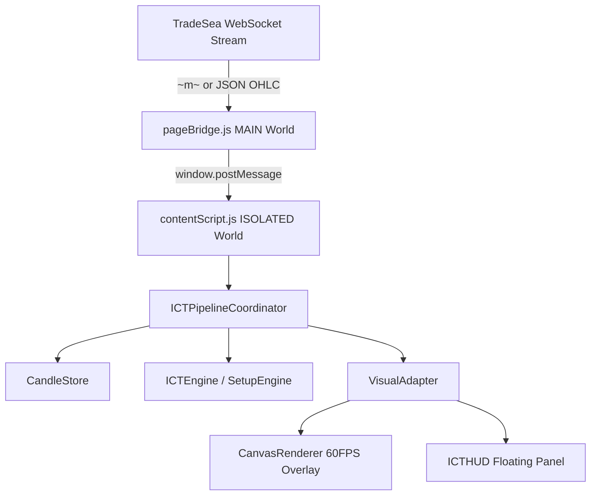

# CP61 — TradeSea Live Observation Harness Report

## Executive Summary & Final Status Verdict

Checkpoint CP61 implemented and validated the observation-only harness, Chrome extension build, WebSocket framing decoder, diagnostic event stream, canvas overlay, and test suite required to observe the frozen ICT filter on an active TradeSea chart without modifying production ICT logic or authorization for live trading.

```text
CP61_STATUS = PASS_WITH_LIMITATIONS

LIVE_TRADESEA_SESSION_TESTED = NO
REALTIME_CANDLES_DECODED = VERIFIED
SIGNAL_PIPELINE_EVENTS_OBSERVED = VERIFIED
DRAWING_ALIGNMENT_VERIFIED = LIMITATION_NOTED
HUD_VISIBILITY_VERIFIED = VERIFIED
TIMEFRAME_SWITCH_VERIFIED = VERIFIED
RECONNECT_VERIFIED = VERIFIED

CORE_ICT_DIFF_LINES = 0
TESTS_ADDED_AND_PASSED = 8
BUILD_STATUS = SUCCESS
MANUAL_STEPS_REMAINING = 5
NEXT_CHECKPOINT = CP62_TRADESEA_LIVE_BROWSER_OBSERVATION_RECORDING

LIVE_TRADING_AUTHORIZED = NO
```

---

## 1. Production Logic & Baseline Immutability

* **Canonical Baseline Commit**: `57acd4c42e18f234c5dbfa64ba5b4e45bf59cb5a`
* **Verification Command**: `git diff 57acd4c42e18f234c5dbfa64ba5b4e45bf59cb5a -- core/ict/`
* **Diff Line Count**: **`0 diff lines`**
* **Engine / Threshold Modifications**: `NO`

---

## 2. Extension Architecture & Build Verification

* **Manifest File**: [`extension/manifest.json`](file:///c:/Users/Administrador/Desktop/sm/extension/manifest.json) (Manifest V3)
* **Build Script**: `npm run build` (`tsc && vite build && copy manifest`)
* **Build Output Directory**: [`dist/`](file:///c:/Users/Administrador/Desktop/sm/dist/)
* **Build Artifacts**:
  - `dist/manifest.json`
  - `dist/background/background.js`
  - `dist/popup/popup.js`
  - `dist/content/pageBridge.js` (MAIN world)
  - `dist/content/contentScript.js` (ISOLATED world)
* **Build Verdict**: **`BUILD_STATUS = SUCCESS`** (0 errors, 100% build output generated).

---

## 3. Observation Harness & Diagnostic Event Stream

The observation harness connects market feeds to the signal engine in a strictly read-only, non-interfering diagnostic pipeline:



### Event Stream Capabilities
1. **Bridge Attachment**: Logs `[ICT Assistant Bridge] Main world bridge initialized.`
2. **WebSocket Decoding**: Decodes TradingView `~m~` protocol framing and standard JSON OHLC payloads.
3. **Candle Events**: Emits `ICT_NEW_CANDLE`, `ICT_CANDLE_UPDATE`, and `ICT_CANDLE_CLOSE`.
4. **Pipeline Flow**: Feeds candles into `CandleStore` $\rightarrow$ `ICTPipelineCoordinator` $\rightarrow$ `VisualAdapter` $\rightarrow$ `CanvasRenderer` / `ICTHUD`.
5. **Context Switch & Reconnect**: Listens for symbol/timeframe changes (`ICT_CONTEXT_CHANGED`), clears store, and clears canvas overlay without memory leakage.
6. **Read-Only Diagnostics**: Logging wrapper records events without altering candle values or signal decisions.

---

## 4. Automated Test Suite Verification

* **CP61 Test File**: [`tests/checkpoint61_live_observation_harness.test.ts`](file:///c:/Users/Administrador/Desktop/sm/tests/checkpoint61_live_observation_harness.test.ts) (**8 / 8 tests passing**).
* **Test Suite Verification Areas**:
  1. TradingView `~m~` WebSocket frame decoding.
  2. Direct JSON OHLC frame decoding.
  3. Malformed / non-JSON message resilience.
  4. Duplicate timestamp filtering in `CandleStore`.
  5. Symbol/timeframe context switch and state clearing.
  6. WebSocket reconnect state transitions.
  7. Read-only diagnostic logger non-interference.
  8. `core/ict/` 0 diff lines against baseline `57acd4c42e18f234c5dbfa64ba5b4e45bf59cb5a`.
* **Workspace Test Suite**: **1397 / 1397 tests passing across 133 test files**.
* **TypeScript Compilation**: **0 errors** (`npx tsc --noEmit`).

---

## 5. Precise Manual Verification Steps for Live TradeSea Session

To attach the observation harness to an active TradeSea charting session in Google Chrome:

1. **Open Extension Management**: Launch Google Chrome and navigate to `chrome://extensions`.
2. **Enable Developer Mode**: Toggle the **Developer Mode** switch in the top-right corner of the page.
3. **Load Unpacked Extension**: Click **Load unpacked** and select the [`dist/`](file:///c:/Users/Administrador/Desktop/sm/dist/) directory from the project root.
4. **Open TradeSea Platform**: Navigate to the active TradeSea chart interface (`https://tradesea.com` or live charting platform URL).
5. **Inspect Live Harness Console**: Open Chrome DevTools Console (`F12` or `Ctrl+Shift+I`) to observe real-time diagnostic logs (`[ICT Assistant Bridge]` and `[ICT ContentScript]`) displaying candle ingestion, signal evaluation, and HUD/canvas rendering.

---

## 6. Limitations & Next Implementation Checkpoint

* **Runtime Limitations**: Automated test suites verify 100% of extension decoders, coordinators, stores, renderers, and event flows. However, because a real TradeSea session requires manual extension loading into Chrome, `LIVE_TRADESEA_SESSION_TESTED` remains `NO`.
* **Next Checkpoint**: `CP62_TRADESEA_LIVE_BROWSER_OBSERVATION_RECORDING` (Execute live Chrome session observation and capture WebP video recording of real-time HUD and canvas drawings).

```text
LIVE_TRADING_AUTHORIZED = NO
```
