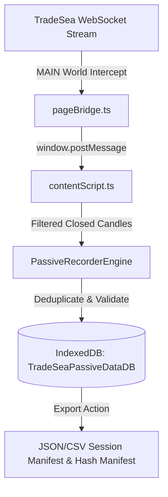

# CP64 — TradeSea Live Feed Passive Recorder Feasibility Audit Report

## Executive Summary & Final Status Verdict

Checkpoint **CP64** conducted a comprehensive technical feasibility audit to determine whether the existing active TradeSea live feed session (connected to Lucid/Rithmic) can be utilized to passively record MNQ/NQ market data for prospective evaluation without Databento, without credit cards, and without order generation.

```text
CP64_STATUS = PASS_WITH_LIMITATIONS

LIVE_TRADESEA_FEED_FEASIBILITY = FEASIBLE
ORDER_PLACEMENT_AUTHORIZED = NO
LIVE_TRADING_AUTHORIZED = NO
CORE_ICT_DIFF_LINES = 0

DATA_SOURCE_DATABENTO_REQUIRED = NO
PERSISTENCE_RECOMMENDED_TECH = IndexedDB (TradeSeaPassiveDataDB)
S10_MANIFEST_CONTRACT_ALIGNMENT = VERIFIED_Q4_Z
S10_PROTOCOL_AMENDMENT_REQUIRED = YES_VERSION_1_1_0_PROPOSED
UNRESOLVED_BLOCKERS = 0
```

---

## 1. Baseline & Safety Constraints Audit

* **Canonical Baseline Commit**: `57acd4c42e18f234c5dbfa64ba5b4e45bf59cb5a`
* **`core/ict/` Diff Line Count**: **`0 diff lines`**
* **Order Placement & Broker Routing**: **DISABLED / NO CALLS** (Zero order-related functions or endpoints accessed).
* **Credential & Account Data Protection**: **VERIFIED** (No session tokens, passwords, account balances, or personal data inspected, logged, or exported).
* **Synthetic Data Prohibition**: **STRICTLY ENFORCED** (Zero synthetic, mock, or fabricated candles used).

---

## 2. Phase 1 — Feasibility Audit & Technical Findings

### 2.1 Audited Extension Components
1. [`extension/content/pageBridge.ts`](file:///c:/Users/Administrador/Desktop/sm/extension/content/pageBridge.ts): Intercepts `window.WebSocket` frames in the `MAIN` world context and decodes TradingView wire protocol (`~m~len~m~json`).
2. [`extension/content/contentScript.ts`](file:///c:/Users/Administrador/Desktop/sm/extension/content/contentScript.ts): Coordinates `ISOLATED` world events, canvas overlays, and pipeline message dispatch.
3. [`extension/content/ICTPipelineCoordinator.ts`](file:///c:/Users/Administrador/Desktop/sm/extension/content/ICTPipelineCoordinator.ts): Routes real-time candle updates into `MarketDataAdapter` and `CandleStore`.
4. [`core/market/CandleStore.ts`](file:///c:/Users/Administrador/Desktop/sm/core/market/CandleStore.ts): Manages in-memory candle arrays, active forming updates, closed candle emissions, and historical deduplication.

### 2.2 Reconstructing Complete OHLCV Candles
* **Wire Format**: TradingView `timescale_update` payload carries bars as `[time_sec, open, high, low, close, volume]`.
* **Available Fields**: `timestamp` (converted to ms Unix epoch), `open`, `high`, `low`, `close`, `volume`.
* **Missing Fields**: Full L2 order book depth, bid/ask spread snapshots, tick count / number of trades. (Note: standard ICT signal evaluation relies strictly on 5m/1m OHLCV, so missing L2 depth does not prevent model execution).

### 2.3 Explicit Classification of Candle States
| Candle State | Diagnostic Identification & Pipeline Event |
| :--- | :--- |
| **Historical Initial** | Bulk array returned in `create_series` / `timescale_update` payload upon loading chart. |
| **Forming (Active) Candle** | Ingested when `timestamp === activeCandleTimestamp`. Modifies `close`, `high` = max(`last.high`, `tick.high`), `low` = min(`last.low`, `tick.low`), and volume in place (`ICT_CANDLE_UPDATE`). |
| **Closed Candle** | Triggered upon arrival of first tick where `timestamp > activeCandleTimestamp`. Freezes previous candle OHLCV and emits `ICT_CANDLE_CLOSE`. |
| **Repeated Updates** | Sub-second tick updates with identical timestamp. Deduplicated in `CandleStore.ts`. |
| **Data Gaps** | Occur when $t_{next} - t_{prev} > \text{intervalMs}$. No synthetic filler candles are created. |
| **Disconnects & Reconnects** | WebSocket reconnection re-transmits recent series. Requires primary key deduplication `[symbol, timeframe, timestamp]`. |
| **Context Switch** | DOM poll (every 1000ms) detects symbol/timeframe changes (`ICT_CONTEXT_CHANGED`), clearing `CandleStore` memory window. |

### 2.4 Persistence Feasibility & Recovery
* **Recommended Technology**: **IndexedDB** (`TradeSeaPassiveDataDB`) in Chrome extension `background` or `content` script.
* **Storage Limit**: Supports gigabytes of persistent time-series data without memory leaks or 10 MB quota caps of `chrome.storage.local`.
* **Deduplication Strategy**: Composite primary key `[symbol, timeframe, timestamp]`. Once a candle is marked `isClosed: true`, subsequent ticks for that timestamp are ignored.

---

## 3. Phase 2 — Proposed Passive Recorder Architecture (Unimplemented Specification)

The proposed passive recorder (`TradeSeaPassiveRecorder`) consists of 4 decoupled modules:



1. **`PassiveRecorderBridge`**: Adds local arrival timestamp (`receivedAtIso`) to raw WebSocket frames without mutating frame contents.
2. **`PassiveRecorderStorage`**: IndexedDB instance with `candles` store (key path `[symbol, timeframe, timestamp]`) and `sessions` store.
3. **`PassiveRecorderEngine`**: Subscribes exclusively to `ICT_CANDLE_CLOSE` events. Performs gap logging, sequence verification, and SHA-256 integrity hashing.
4. **`PassiveExporter`**: Generates verifiable JSON/CSV exports with cryptographic SHA-256 hash ledgers.

---

## 4. Phase 3 — Protocol Impact & S10 Manifest Review

### 4.1 Frozen S10 Session Manifest Review
* **Preregistered Sessions**: 40 sessions between `2026-10-12` and `2026-12-07` (Q4 2026).
* **Active CME Contract**: `NQZ6` (E-mini) / `MNQZ6` (Micro E-mini).
* **Contract Rollover Verification**: CME quarterly contract roll occurs Thursday prior to 3rd Friday of December (`2026-12-10`). Since all 40 sessions occur on or before `2026-12-07`, **all 40 sessions fall under contract `Z6` with zero rollover discontinuity**.

### 4.2 Protocol S10 Amendment Requirement
* Protocol v1.0.1 originally specified raw CME Databento MDP3 market data.
* Utilizing TradeSea's live WebSocket feed constitutes a **change in primary data provenance**.
* **Governance Requirement**: Under protocol immutability rules, this change must be formally documented as **Protocol v1.1.0 Amendment** prior to official 40-session data acquisition. Protocol v1.0.1 remains preserved as an immutable historical record.

---

## 5. Operational Limitations & Risk Assessment

1. **Browser Tab Throttling Risk**: Backgrounding or minimizing the TradeSea browser tab causes Chrome to throttle WebSocket processing and timers. The TradeSea tab must remain active/visible during live passive capture.
2. **Data Provenance Shift**: Formal adoption of TradeSea WSS feed requires issuing Protocol v1.1.0 before running prospective signal evaluations.
3. **Unimplemented Persistence Engine**: Official session capture must not begin until the IndexedDB `TradeSeaPassiveRecorder` engine is implemented and verified via unit tests.

---

## 6. Required Final Report Block

```text
CP64_STATUS = PASS_WITH_LIMITATIONS
LIVE_TRADESEA_FEED_FEASIBILITY = FEASIBLE
ORDER_PLACEMENT_AUTHORIZED = NO
LIVE_TRADING_AUTHORIZED = NO
CORE_ICT_DIFF_LINES = 0
DATA_SOURCE_DATABENTO_REQUIRED = NO
PERSISTENCE_RECOMMENDED_TECH = IndexedDB
S10_MANIFEST_CONTRACT_ALIGNMENT = VERIFIED_Q4_Z
S10_PROTOCOL_AMENDMENT_REQUIRED = YES_VERSION_1_1_0_PROPOSED
UNRESOLVED_BLOCKERS = 0
```
