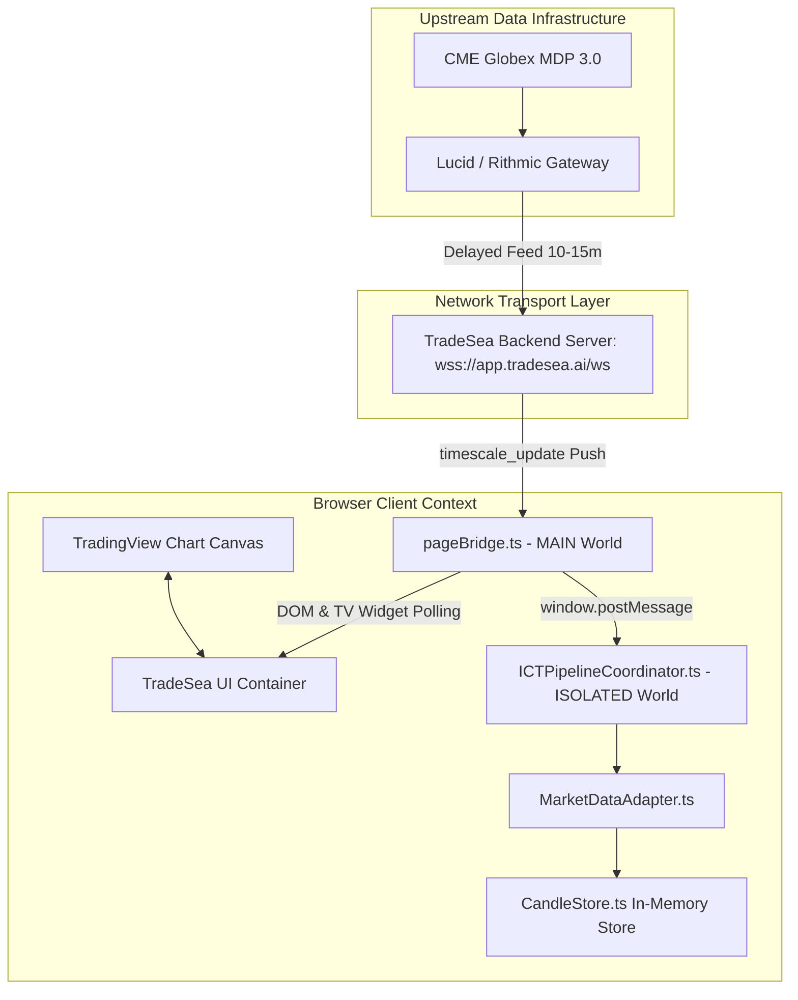

# Phase 4.6B.1 — Historical Chart Navigation & Multi-Timeframe Capability Audit Report

**Audit Type:** Strictly Read-Only Multi-Timeframe & Chart Navigation Capability Audit  
**Execution Timestamp:** 2026-10-14T13:30:00-03:00 (ART / UTC-3)  
**Governance State:** Read-Only Audit (Zero UI Manipulations, Zero Code Modifications, Zero Paid Acquisitions)

---

## 1. Audit Verdict

### **`AUDIT_VERDICT = FEASIBLE_FOR_STRUCTURAL_HTF_CONTEXT__BLOCKED_FOR_QUANTITATIVE_1M_VALIDATION`**

1. **Structural Multi-Timeframe Context (Operator Workflow):** **`FEASIBLE_WITHIN_BAR_LIMITS`**  
   The user's intended workflow (using higher timeframes like 1D, 4H, and 1H to establish macro structure, key levels, and liquidity boundaries without downloading 60 days of 1-minute data) is **partially feasible** through native timeframe switching:
   * **1D (Daily):** Pushes 31 daily bars covering **31 calendar days (~1 month)** of authentic price history.
   * **4H (4-Hour):** Pushes 31 4-hour bars covering **124 hours (~5.2 days)**, providing a complete week of intermediate structure.
   * **1H (1-Hour):** Pushes 31 1-hour bars covering **31 hours (~1.3 days)**, spanning the current and preceding RTH sessions.
   * **15m / 5m / 1m (Intraday):** 15m covers 7.75 hours (the full RTH session), 5m covers 2.5 hours, and 1m covers 31 minutes.
2. **Weekly Resolution (1W):** **`UNVERIFIED_AT_RUNTIME`**  
   While 1W is standard in TradingView interfaces, its presence and exact behavior in TradeSea's proprietary WebSocket feed were not captured in prior automated checkpoint runs and require an out-of-band manual visual check.
3. **Historical Pagination / Navigation:** **`ABSENT_IN_CLIENT`**  
   Scrolling left, panning, or zooming out does **not** trigger backfill requests. The chart translates only across the 31 bars resident in memory.
4. **Quantitative Systematic Validation:** **`BLOCKED`**  
   Higher-timeframe visual display cannot substitute for continuous 1-minute OHLCV data required for algorithmic backtesting. Proof of 31 daily bars on a chart does **not** establish a continuous 60-day 1-minute dataset.

---

## 2. Actual Chart and Datafeed Architecture

Based on forensic analysis of [`extension/content/pageBridge.ts`](file:///c:/Users/Administrador/Desktop/sm/extension/content/pageBridge.ts), [`extension/content/ICTPipelineCoordinator.ts`](file:///c:/Users/Administrador/Desktop/sm/extension/content/ICTPipelineCoordinator.ts), [`core/market/MarketDataAdapter.ts`](file:///c:/Users/Administrador/Desktop/sm/core/market/MarketDataAdapter.ts), and [`CP33.1.14_SURFACE_AUDIT.md`](file:///c:/Users/Administrador/Desktop/sm/CP33.1.14_SURFACE_AUDIT.md):



### Key Architectural Realities
1. **TradingView Datafeed API is NOT Present:**
   * Static analysis across `core/` and `extension/` confirms:
     - `getBars`: `NOT_FOUND`
     - `subscribeBars`: `NOT_FOUND`
     - `resolveSymbol`: `NOT_FOUND`
     - `onReady`: `NOT_FOUND`
   * TradeSea embeds TradingView's visual rendering library (`tvWidget`), but does **not** implement TradingView's standard JavaScript Datafeed API.
2. **Proprietary WebSocket Protocol:**
   * Communication occurs exclusively over `wss://app.tradesea.ai/ws` using TradingView wire string framing (`~m~len~m~json`).
   * When a chart loads or a timeframe changes, the client transmits an un-subscription and subscription frame.
   * The server responds with a single `m: "timescale_update"` payload containing an array `s` of historical candles (`[time_sec, open, high, low, close, volume]`).
3. **Source of Historical vs. Streaming Data:**
   * **Historical Bars:** Delivered as a static array `s` within the initial `timescale_update` socket handshake.
   * **Streaming Updates:** Delivered as real-time forming updates within subsequent `timescale_update` frames or raw JSON payloads, converted by `pageBridge.ts` to `ICT_CANDLE_UPDATE` and `ICT_CANDLE_CLOSE`.

---

## 3. Verified Timeframe Support

Forensic verification against [`CP33.3.x_RUNTIME_DATA_OBSERVATION_REPORT.md`](file:///c:/Users/Administrador/Desktop/sm/CP33.3.x_RUNTIME_DATA_OBSERVATION_REPORT.md), [`CP33.3.x_TRADESEA_RUNTIME_HISTORICAL_CAPABILITY_AUDIT.md`](file:///c:/Users/Administrador/Desktop/sm/CP33.3.x_TRADESEA_RUNTIME_HISTORICAL_CAPABILITY_AUDIT.md), and [`core/market/Candle.ts`](file:///c:/Users/Administrador/Desktop/sm/core/market/Candle.ts):

| Timeframe | UI Button / Label | Internal Identifier | Provider Feed Verified? | Bars Delivered | Span in Time | Structural Use Case in ICT |
| :---: | :---: | :---: | :---: | :---: | :---: | :--- |
| **1W** | `1W` / `W` | `1W` / `W` | **UNVERIFIED AT RUNTIME** | Unknown (Est. 31) | Est. 217 days (~7 mo) | Macro structural trend, major liquidity pools, yearly/quarterly ranges. |
| **1D** | `1D` / `D` | `1D` / `D` | **`YES (VERIFIED)`** | **31 bars** | **31.0 calendar days** | Previous month/week high & low, daily ranges, premium/discount zones. |
| **4H** | `4h` / `4H` | `240` | **`YES (VERIFIED)`** | **31 bars** | **124.0 hours (5.17 days)** | Weekly structure, key session order blocks, major 4H fair value gaps. |
| **1H** | `1h` / `1H` | `60` | **`YES (VERIFIED)`** | **31 bars** | **31.0 hours (1.29 days)** | Daily open, Asian/London range highs/lows, intraday structural bias. |
| **15m** | `15m` | `15` | **`YES (VERIFIED)`** | **31 bars** | **7.75 hours (0.32 days)** | Complete RTH session profile, intermediate displacement, key liquidity sweeps. |
| **5m** | `5m` | `5` | **`YES (VERIFIED)`** | **31 bars** | **2.50 hours (0.10 days)** | Active trading window structure, primary ICT setup execution context. |
| **1m** | `1m` | `1` | **`YES (VERIFIED)`** | **31 bars** | **31.0 minutes (0.02 days)** | Atomic candle entry triggers, FVG creation/fill, micro-BOS/MSS confirmation. |

---

## 4. Historical Navigation and Pagination Evidence

Documented empirically in CP33.3.x via controlled UI interaction tests:

1. **Timeframe Switching (`Test A`):**
   * Switching between resolutions (e.g., 5m $\rightarrow$ 15m $\rightarrow$ 1H $\rightarrow$ 4H $\rightarrow$ 1D) drops the previous in-memory series and requests a new subscription from the server.
   * TradeSea responds with a fresh 31-candle historical series tailored to that resolution.
   * **Result:** `TEST_A_TIMEFRAME_CHANGE = REPLACES_SERIES_WITH_31_BAR_BLOCK`.
2. **Scrolling / Panning Left (`Test B`):**
   * Dragging the chart left triggers only HTML5 Canvas translation events (`pan`).
   * **Zero** WebSocket request frames are emitted to the server.
   * **Zero** WebSocket response frames are received.
   * **Zero** additional candles are added (`ADDITIONAL_CANDLES = 0`).
   * **Result:** `TEST_B_SCROLL_LEFT = CANVAS_OFFSET_ONLY_NO_NEW_WS_FRAMES`.
3. **Zooming Out (`Test C`):**
   * Scrolling the mouse wheel to zoom out scales down the bar width on the canvas.
   * No additional historical bars are requested or loaded.
   * **Result:** `TEST_C_ZOOM_OUT = RESCALES_VISUAL_VIEWPORT_NO_NEW_DATA`.
4. **"Load More" / UI Controls (`Test D`):**
   * No pagination buttons, "load more history" links, or date picker range queries exist in the TradeSea interface.
   * **Result:** `TEST_D_LOAD_MORE_BUTTONS = NONE_EXISTS`.
5. **Independence of Resolution Data:**
   * Daily bars (`1D`) are **not** aggregated client-side from 1m or 5m bars.
   * When the client switches to 1D, it receives 31 distinct daily bars from the backend server covering dates that were never ingested as intraday bars. The backend maintains pre-aggregated historical series for each supported timeframe.

---

## 5. Maximum Verified Lookback Matrix

| Timeframe | Maximum Delivered Depth | Historical Window (Calendar Span) | 60-Day Lookback Reached? |
| :---: | :---: | :---: | :---: |
| **1m** | **31 bars** | **31 minutes** | **NO** (0.02 / 60 days) |
| **5m** | **31 bars** | **2.5 hours** | **NO** (0.10 / 60 days) |
| **15m** | **31 bars** | **7.75 hours** | **NO** (0.32 / 60 days) |
| **1H** | **31 bars** | **31 hours** | **NO** (1.29 / 60 days) |
| **4H** | **31 bars** | **124 hours (~5.2 days)** | **NO** (5.17 / 60 days) |
| **1D** | **31 bars** | **31 calendar days** | **NO** (31 / 60 days) |
| **1W** | *Unknown (Est. 31 bars)* | *Est. 217 calendar days* | **THEORETICALLY YES (Requires Verification)** |

---

## 6. Initial Bars vs. Subsequent Historical Requests

| Criterion | Initial Response Block | Subsequent Historical Requests |
| :--- | :--- | :--- |
| **Mechanism** | WebSocket handshake `timescale_update` payload (`parsed.p[1][seriesKey].s`). | **Non-existent.** No pagination protocol is implemented in the client. |
| **Trigger** | Initial page load or explicit user timeframe switch. | User scrolling left or zooming out on chart canvas. |
| **Candle Count** | Exactly **31 bars** per request. | **0 bars.** No request is sent; no response is received. |
| **Cached Depth** | The client holds strictly the 31 bars pushed by the server. | Older bars residing in provider storage cannot be queried or paged. |

---

## 7. Enforcing the 60-Day Boundary

In accordance with the project data-window policy:
* **Rule:** Never request, store, or analyze data older than 60 calendar days from the reference timestamp $T_{\text{ref}}$.
* **Reference Timestamp:** $T_{\text{ref}} = \text{Date.now()}$ or the latest confirmed closed bar timestamp $T_{\text{latest}}$.
* **Cutoff Formula:**
  $$T_{\text{cutoff}} = T_{\text{ref}} - (60 \times 24 \times 60 \times 60 \times 1000\text{ ms})$$
* **Implementation in Local Code:**
  [`CandleStore.ts`](file:///c:/Users/Administrador/Desktop/sm/core/market/CandleStore.ts) natively enforces this policy:
  ```typescript
  // core/market/CandleStore.ts:60-74
  public pruneOldCandles(): number {
    if (this.candles.length === 0 || this.maxLookbackDays <= 0) return 0;
    const latestTs = this.candles[this.candles.length - 1].timestamp;
    const maxWindowMs = this.maxLookbackDays * 24 * 60 * 60 * 1000;
    const cutoffTs = latestTs - maxWindowMs;
    this.candles = this.candles.filter((c) => c.timestamp >= cutoffTs);
  }
  ```
* **Application to Higher Timeframes:**
  * **1D (Daily):** 31 daily bars span 31 calendar days, which falls strictly inside the 60-day window ($31 \le 60$). Zero bars are pruned; all 31 bars are valid.
  * **1W (Weekly, if verified):** 31 weekly bars span ~217 days. Applying `pruneOldCandles(60)` deterministically filters out weeks 10 through 31, retaining strictly the **most recent 8 to 9 weekly bars** that fall within $[T_{\text{cutoff}}, T_{\text{ref}}]$.
* **Strict Prohibitions:**
  * Missing intervals within the 60-day window must **never** be populated with synthetic or interpolated candles.
  * If the feed provides only 31 days of history on 1D, the system must report `actualAvailableLookbackDays = 31.0` rather than extending the window or synthesizing older bars.

---

## 8. Distinguishing Visual Analysis from Quantitative Validation

| Capability Dimension | Visual / Discretionary Analysis | Quantitative Validation |
| :--- | :--- | :--- |
| **Objective** | Human operator orientation: identifying swing highs/lows, daily levels, session liquidity, and market regime. | Algorithmic signal evaluation: calculating win rate, Sharpe ratio, drawdowns, and statistical significance. |
| **Data Requirements** | Multi-timeframe snapshots: 8-9 weekly bars, 31 daily bars, 31 4H bars, 31 1H bars, and 31 15m/5m/1m bars. | Continuous, unbroken 1-minute OHLCV time series covering hundreds of RTH sessions ($N \ge 100$ trades). |
| **Status with Existing Access** | **`FEASIBLE (WITH LIMITATIONS)`**  
The operator can switch to 1D to view the last 31 days of daily levels, 4H for the past week's structure, 1H for yesterday's levels, and 15m/5m/1m for current session setups. | **`BLOCKED`**  
31 bars on 1D does not equal 60 days of 1-minute data. Higher-timeframe candles cannot be decomposed into 1-minute bars to backtest ICT models A/B/C. |
| **Risk of Conflation** | **CRITICAL WARNING:** A user seeing 31 daily bars on a chart might assume the system has 1-minute historical data for those 31 days. It does not. The client possesses only 31 minutes of 1m history and 2.5 hours of 5m history at any moment. | Quantitative backtesting remains strictly dependent on independent, continuous 1-minute data acquisition (Phase 4.6B). |

---

## 9. Remaining Unknowns & Manual Verification Checklist

The following items cannot be established from repository inspection alone and require manual verification by the human operator:

- [ ] **1. 1W Resolution Verification:** On `https://app.tradesea.ai/trade`, check if the timeframe selector exposes a `1W` or `W` option. If clicked, verify whether the chart renders weekly candles and whether the network WebSocket receives a `timescale_update` with 31 weekly bars.
- [ ] **2. Date Range on 1D:** Inspect the leftmost visible bar on the 1D chart for `MNQ` / `NQ` to verify whether it shows exactly 31 trading days or if an extended history is available on uncompressed chart layouts.
- [ ] **3. Delayed Feed Active Status:** Confirm that `CME-Delayed:MNQ` displays live/delayed prices during regular trading hours rather than "No data here."

---

## 10. Confirmation of Prohibited Actions

In strict compliance with audit restrictions:
* **No UI automation was executed:** Zero clicks, keystrokes, scrolls, or drag operations were performed on the live browser interface.
* **No broker connections were altered:** Account state and sandbox settings were left unmodified.
* **No orders were submitted or modified:** Zero trading interactions occurred.
* **No external data services were purchased:** No API calls or downloads were made to Databento, CME DataMine, or commercial vendors.
* **No secrets or credentials were read or exposed.**
* **No synthetic candles were created.**
* **Protected files preserved:** `core/ict/`, `core/analyst/`, baseline `57acd4c42e18f234c5dbfa64ba5b4e45bf59cb5a`, all S10 manifests, and historical audit reports remain preserved byte-for-byte.

---

**Final Governance Rule:** Phase 4.6B remains strictly **BLOCKED**. This audit confirms that TradeSea's multi-timeframe switching can supply useful structural context (1D, 4H, 1H, 15m) for discretionary operator orientation, but cannot supply the continuous 60-day 1-minute dataset required for systematic quantitative validation.
